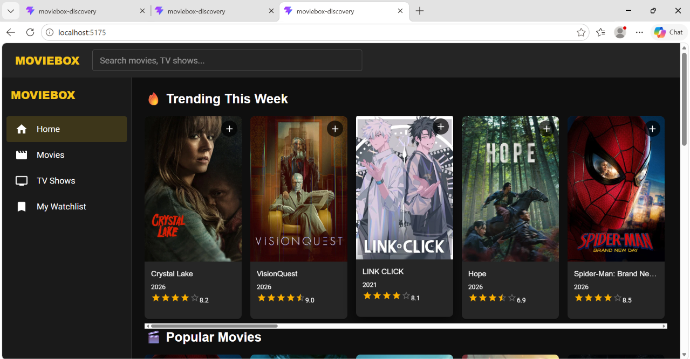
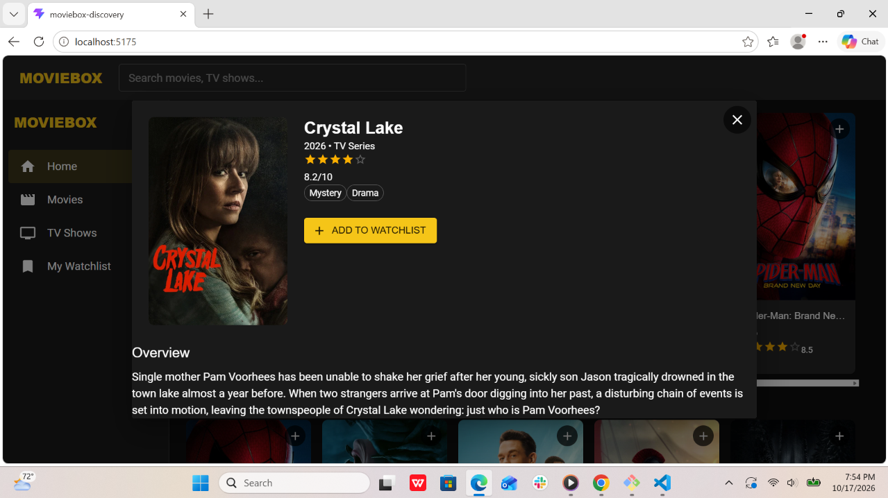

# AARONIX Movie Discovery App

A responsive movie and TV show discovery application built with React, Vite, and Material UI. Data is sourced live from The Movie Database (TMDB) API. 

This project was built as a university assignment to demonstrate React component architecture, API integration, and responsive UI design.

## Features
- Homepage: Browse Trending, Popular, Top Rated, and TV Shows in horizontal scrolling rows.
- Details View: Click any poster to see the overview, release year, rating, and genres in a beautiful modal.
- Trailers: Watch official YouTube trailers directly inside the movie details modal.
- Search: Search for movies and TV shows in real-time using the top search bar.
- Filtering: Filter movies and TV shows by specific genres on their respective pages.
- Watchlist: Add or remove items from your personal watchlist. The data persists across page reloads using the browser's localStorage.
- Responsive Design: Fully responsive layout with a permanent sidebar on desktop and a hamburger drawer menu on mobile. 

## Technologies Used
- React (Vite): Frontend framework and blazing-fast build tool.
- Material UI (MUI): UI components, icons, and dark theme styling.
- React Router: Client-side routing for Home, Movies, TV Shows, Search, and Watchlist.
- Axios: HTTP client for making API requests.
- TMDB API: Live movie and TV show data.

## How to Run Locally
1. Clone the repository:
   git clone https://github.com/aaronamanya45-bot/moviebox-discovery.git
   cd moviebox-discovery

2. Install dependencies:
   npm install

3. Create a .env file in the root directory and add your TMDB API key (you can get a free one at themoviedb.org):
   VITE_TMDB_API_KEY=your_tmdb_v3_api_key_here
   VITE_TMDB_BASE_URL=https://api.themoviedb.org/3
   VITE_TMDB_IMAGE_BASE=https://image.tmdb.org/t/p

4. Start the development server:
   npm run dev

5. Open http://localhost:5173 in your browser.

## Screenshots

## Attribution
This product uses the TMDB API but is not endorsed or certified by TMDB. All movie posters and metadata are provided by The Movie Database (TMDB). 
 
 
 
 
